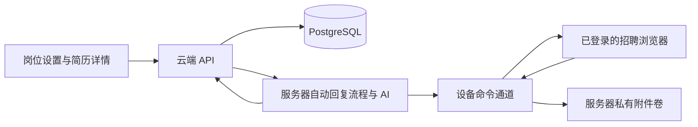

<!-- 文件作用：说明自动回复服务器组件的运行边界、环境、文件与验证办法。 -->

# 自动回复运行服务

在云端内网运行 goodhr-auto-reply-server。它执行聊天判断、条件复核、简历结构化、服务器AI图片识别和推荐报告，数据库由现有 Go 后端管理。本机使用已登录的浏览器执行平台动作，读取聊天、上传附件和回报发送结果。平台消息送达以后记录实际出站消息键；平台没有原生消息编号时不得伪造编号。

2026-11-10新增的BOSS操作、在线临时资料、严格同人匹配、30天清理及OCR停用规则见[《BOSS自动回复与在线临时简历》](../../docs/BOSS自动回复与在线临时简历.md)。公开版本仍灰度关闭，隔离验证不代表已经对所有账号开放。

## 数据与动作边界



聊天原文、目标证据、AI 调用、操作时间线、发送回执、待确认问题和推荐报告均由服务器保存。服务器内存里的 SQLite 只用于执行已有事务，每次变更须经 PostgreSQL 版本检查并提交。设备只持有本轮操作、回执和临时下载；服务端确认附件后，设备按文件摘要及修改时间清理本次下载，不删除用户后来修改的文件。招聘平台的 Cookie、登录 Profile 和设备权限仍属于执行设备。

首次来信优先读取在线基础资料：BOSS设备复用既有长截图和拼图，图片经命令通道交服务器AI；猎聘直接读取独立可见DOM。`read_online_profile`命令和在线保存API均核对真实会话及岗位，来源摘要与读取证明一致才保存。同代缓存命中不重新截图或调用图片AI；图片字节转录后清空，不写入候选人权威缓存。在线资料不代表已收到附件，也不伪造完整结构化经历。

BOSS出站正文在答复及发送Claim前统一定稿为单行，服务器意图、设备草稿和真实新己方消息使用同一正文严格核对。点击、Enter调用成功或输入框清空均不能单独证明送达；结果未知保留意图并停止，不能盲目重发。原生电话、微信、简历请求同样依赖各类型真实新回执，未满足双向沟通条件时仅暂缓，不文字降级。

同一 GoodHR 账号在新网页续签登录后，设备继续使用已验证的新凭证提交同一回执，不能因 Token 变化丢弃已完成的浏览器操作。切换账号或退出登录时立即取消旧运行；即使随后登录原账号，也需要重新启动任务。此检查在跨平台 Go 公共层执行，Windows、Mac arm64/amd64 使用相同规则。

HR 补充的岗位或公司事实独立保存，并在执行快照中标明高于原文“待确认”的旧说明。问题原话按来源消息归档，相似问题合并来源；同一版本的答复只补答一次。正文已明确索要简历时，使用 `requests_resume` 标记，流程只记等待状态，不再追加索要卡和相同话术。BOSS等启用原生资料索要的平台按独立账本处理简历、电话和微信：条件不足明确暂缓，不降级为文字重复索要；结果不明时停止追加发送。其它平台继续使用各自已验证能力，不能套用BOSS页面结构。

## 准备配置

| 位置 | 环境变量 | 用途 |
| --- | --- | --- |
| 云后端及编排服务 | GOODHR_AUTO_REPLY_SERVICE_TOKEN | 两边相同的随机私有凭证，至少 16 字符。通过运行环境注入，禁止写入镜像或前端。 |
| 云后端 | GOODHR_AUTO_REPLY_RUNTIME_URL | 编排服务的内网地址，例如 http://auto-reply:18646 。 |
| 编排服务 | GOODHR_BACKEND_URL | 云后端的内网地址，须能访问现有用户 API 与 /internal/auto-reply/state/ 。 |
| 编排服务 | GOODHR_AUTO_REPLY_LISTEN | 进程监听地址。本地运行默认 127.0.0.1:18646，容器镜像设为 0.0.0.0:18646。 |
| 云后端及编排服务 | GOODHR_AUTO_REPLY_FILES_DIR | 两服务挂载同一私有持久卷，使用相同绝对目录。每个租户和用户独立保存附件。 |
| 云后端 | GOODHR_TEMP_RESUME_CLEANUP_TOKEN | 临时在线资料清理的独立维护令牌，至少32字符；POST发起、GET查询均要请求头鉴权，详见上方功能文档。 |

候选镜像从模块目录使用 Dockerfile.auto-reply-server 构建，Go 为 1.25。当前运行层不安装Tesseract，扫描附件渲染后交服务器AI识别；本机OCR源码与历史文件保留但不参与运行。编排服务使用 UID/GID 65532，部署时让后端和编排服务以同一 UID 读写该私有卷（子目录为 0700，原件为 0600）。后端和编排服务共享私有网络；对外仅开放原云后端。Linux amd64 和 arm64 使用相同构建文件。正式发布仍使用项目规定的不可变候选、隔离验收与回退流程。

在 goodhr5 目录运行以下检查。构建时使用同一份 Dockerfile 的 SHA-256 填入镜像标签 `goodhr.dockerfile_sha256`，并以 `goodhr.release.id` 标记不可变候选。将 `CANDIDATE_IMAGE` 设置为该候选的完整标签或镜像 ID。

```shell
python3 scripts/release_guard.py dockerfiles --auto-reply local-agent-go-new/Dockerfile.auto-reply-server
python3 scripts/release_guard.py image --kind auto-reply --image "$CANDIDATE_IMAGE" --dockerfile local-agent-go-new/Dockerfile.auto-reply-server
```

## 核验运行

1. 在编排服务内网访问 GET /health，确认服务存活。随后在隔离授权验证版本中启动目标岗位，核验设备身份、PG 租约与模型请求；公开灰度入口保持关闭。
2. 启动后只有该设备可以领取命令。每次流程操作先核验当前账号的云数据版本。内存 SQLite 只用于执行已有业务事务，所做更改必须得到 PG 版本提交确认。
3. 候选人消息、工具记录、发送回执、资料待办和历史进度在服务器查询。设备断开时保留发送意图，结果不明的消息需要人工复核。
4. 附件首先校验来源会话、消息编号、字节数和摘要，PG 保存引用，文件保存在私有持久卷中。备份和恢复时，使用匹配的数据库与附件卷。
5. 服务器在成员账号锁内安装附件并提交回执。删除最后一个引用后，后端每 2 秒处理受管文件回收，停止岗位也会执行。卷尚未挂载或文件摘要、路径异常时保留待办，约 1 分钟后重试。后端启动时及每 15 分钟检查运行暂存目录；对超过两小时的意图重新核对 PG 引用，只回收无引用的原件和过期暂存。

无有效完整手机号的在线临时资料由云后端`/api/internal/temporary-resumes/cleanup`维护接口清理，POST登记当天任务、GET查询进度，均使用独立清理令牌。开启和关闭结构化入库两条路径都在服务器保留临时来源凭据；资料变化及真实平台沟通可续期，系统通知、查看、轮询和旧消息重放不写当前活动时间。首次在线建档会使用已验证的真实入站时间单调补齐最后沟通时间，缺失或未来时间不猜。生产每日POST须由运维明确安排，本文没有创建线上计划任务。

AI的`source_ref`与逐字原文约束仍在本轮补强和验证，不能宣称已完成整链验收。当前仅确认BOSS在线reader10.454秒（其中既有长截图5.330秒）及猎聘DOM7项必要字段和原生身份恢复9.581秒；BOSS实际自动发送、电话/微信及附件整链仍待真实验收。

若出现 `CANDIDATE_REOPEN_PROOF_CONFLICT` 或 `CANDIDATE_REOPEN_TARGET_CONFLICT`，此次新资料尚未发布。服务器保留已核实的新来信、PDF、结构化结果和发送回执。请在简历库核对旧档及删除记录，再重试同步。历史 410 或当次 409 只能拒绝发布；清理候选数据需要独立核实的删除事件。旧程序已封印错误代次的会话，从重新观察后的真实新入站和新附件恢复；平台时间只有分钟时，需出现晚于观察边界的可核实消息。
