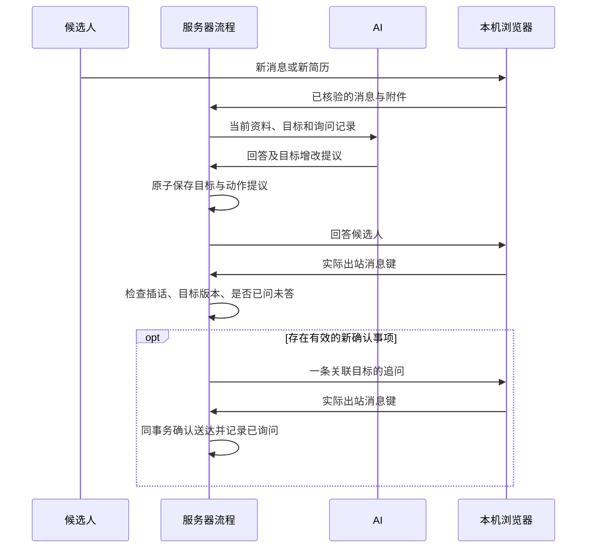

<!-- 文件作用：说明动态沟通目标、主动追问、统一待确认入口和可编辑资料的服务器职责与数据边界。 -->
# 动态沟通目标与待确认工作台

## 目标和发送

HR 配置的岗位条件仍决定招聘要求与推荐准入。AI 可以为当前候选人新增、修改和归档沟通目标，例如确认方便联系的时间。AI 自建目标不会自动变成新的招聘门槛，也不能删除 HR 必要条件。

动态目标复用服务器原有确认项存储和原子提议提交，不建立本机目标库。归档停止后续追问，历史操作保留；目标正文改变后，旧正文的证据或待发问题不能直接沿用。

简历补齐也是新的证据事件，可以继续检查尚未完成的沟通目标，不必等待候选人再次发文字。已经询问且等待回答时不立即重复问；没有新消息、新资料或有效目标变化时不反复调用模型催问。候选人插入新消息、拒绝继续沟通、HR 接管或目标已变化时，旧追问应停止。

普通消息的首条答案先送达。如果模型只回答、没有规划下一步且没有已问未答的目标，服务器仅为这条新消息再做一次受限目标复核，最多发一条追问，复核上限45秒并持续检查候选人是否插话。领取与完成状态复用服务器提议回执，重启不反复调用。已规划追问、已索简历或已有简历待办时由原路径继续，不叠加复核。

目标和版本只在服务器执行与校验，不传入本机浏览器业务协议。设备仅执行原有平台白名单操作。断线只重交同一回执，不重新发送；确认项的询问记录和发送确认须在同一权威事务中保存。

## 待确认入口

岗位管理顶部自动回复按钮打开工作台，启停动作与待确认列表放在面板内。右上角数量由服务器一次汇总，不逐岗位下载原话。面板离线可打开，只有启动浏览器执行才需要本机连接。

数量统计当前账号可答岗位的 pending、failed，以及超过两分钟未完成的 processing 问题；有效处理中和已解决不计入。超时归档保留原答复，以待重试状态重新出现，不需要 HR 去历史记录里找回。关闭岗位仍保留待处理事项，同题多条原话只算一个问题，已清理的空问题不出现。读取失败须显示未知或错误提示，不能冒充零条。

列表按岗位和筛选条件分页，只获取当前页原话。标题展开原话，回复使用原问题版本接口；切岗位或翻页时保留未保存草稿，旧请求不得覆盖当前列表。分页游标绑定岗位和筛选，数据已变更时重新加载第一页。

## HR 补充和人工编辑

AI 只提取 HR 已明确确认的事实并判断归入岗位或公司。归档在数据库事务中合入真实可编辑正文，保留无关原文，并检查岗位版本与公司更新时间，避免旧快照覆盖新资料。

旧版已归档事实一次性迁入正文，之后不再在执行快照或问题索引里补回旧答案。人工编辑、改写或删除正文后，下一轮只使用新的正文。旧问题和答复供审计，不能作为覆盖当前资料的隐形事实源。模型看到的历史 self 消息只保留方向、来源和时间，不提供已失效正文；候选原话、资料状态和目标询问记录保留，原始服务器聊天和详情展示不变。

同一答复按版本只归档和追答一次。人工改写之后，尚未发送的旧补答须重新核验；候选人带来新问题且现有正文无法回答时，可以重新打开原问题，不产生同义重复待办。简历永久删除继续清理关联候选人原话和答复中的敏感内容。

表格草稿绑定开始编辑时的答复版本。其他页面更新同题后，保留草稿并显示最新已保存答复；HR 明确核对后才基于新版本继续，不能在后台轮询时偷偷替换提交版本。持久追问另外绑定公司、岗位、话术和提示词指纹；旧版缺少指纹的草稿放下，不在恢复后继续发出。已开始执行的浏览器动作以实际回执为准。

## 验证重点

- AI 目标创建、同义合并、正文修改、归档及硬条件保护。
- 先答后问、插话取消、补简历触发、已问未答、断线和重启防重。
- 关闭岗位计数、同题多来源、成员与团队隔离、游标翻页和草稿保留。
- HR 补充后真实编辑框可见，人工修改或删除后模型和待发补答不再使用旧值。
- 旧数据迁移只执行一次，版本冲突不覆盖人工内容。
- 全部业务数据在服务器；本机保持临时浏览器执行，Windows 与两种 Mac 架构均需编译验证。

## 2026-11-09 隔离猎聘验收

使用邓云川与郭星原对话，仅处理该候选人。数据库从原实测库恢复为独立候选库，保留原库和恢复前备份；本轮没有部署生产。真实浏览器使用全部列表、回车发送、Esc 关闭；其他候选人不处理。

| 真实操作 | 观察结果 |
| --- | --- |
| 公司正文把地址A改为B，再问地址 | 实际回复B；旧问题里的A仅留审计，不覆盖正文 |
| 问员工停车，HR填写免费停车说明 | 自动登记一题，标题展开原话；保存后真实公司编辑框出现该段，候选端收到一次补答 |
| 人工删掉停车说明，再问同义问题 | 首轮发现模型从历史己方回复补回旧事实；修复历史投影后，原问题重开为待处理，累计两条原话，数量仍为1，实际回复固定待确认话术 |
| 待确认回执之后 | AI主动创建联系时段目标并单独追问，询问次数为1；等待期间不重复问 |
| 回答工作日19点后，再改成周末10–12点 | 同一个目标更新证据并保持已满足，不新建同义目标；HR成都条件保留 |
| 只投递附件，不再发文字 | 先签收，再下载、解析、发布简历；随后新增到岗日期目标并主动追问 |
| 明确12月1日可到岗 | 到岗目标变为已满足，证据关联本条原话 |
| HR把停车信息重新核实为园区收费 | 合入可编辑公司正文，仅一次补答；再次问停车，实际答复按园区收费，没有免费承诺 |
| 候选人明确仅用小程序文字，不安排电话 | AI归档电话目标；到岗目标、HR成都条件仍保留，没有继续追问电话 |

最终服务器保留35条平台消息、19条已发送意图（含之前6条）。本轮9条候选来信/简历卡及13条出站消息均可在详情逐条核对；另有1条平台安全提示。D08结束到合并回归前，超过两分钟没有新增发送。候选详情区分岗位条件与AI目标，已归档目标不计当前进度，原始消息和操作审计保留。本机23张旧自动回复表仍全部为0；候选库保留2份服务器附件，其中本轮新增1份，各241120字节，来源与下载均能核验。

### 本轮实际耗时

计时从候选端点击发送完成，到招聘页真实消息键核验入账；单位为秒。D04在程序重新启动前发出，包含人工启动等待，单列处理而不计为正常响应样本。

| 步骤/样本 | 观测耗时 |
| --- | ---: |
| D05：发现候选新消息 | 4.29 |
| D05：AI更新联系目标并生成答复 | 6.05 |
| D05：完整回复入账 | 16.17 |
| D07：更新时段、确认到岗并答复 | 15.86 |
| D08：归档电话目标并答收费问题 | 17.06 |
| D09：合并后重启，再问地址与停车 | 12.42 |
| 附件投递到固定签收 | 10.67 |
| 附件浏览器采集 | 7.59 |
| 简历AI结构化 | 12.38 |
| 新简历目标复核 | 5.06 |
| 附件投递到自主到岗追问入账 | 48.35 |

附件各步骤串行中还包含检测、消息读取、上传保存及真实发送核验，不能只把三个AI/采集数字相加当作端到端时间。本轮未在完全相同数据下重跑旧版，不计算节省比例。

本轮另观察到一次模型在确认到岗时附带当前B座地址。核对真实输入后，待回复批次确实只有当次一条消息，历史消息没有重新进入待回复队列；这属于模型多补一句当前资料，原文保留供后续措辞评估。

### 自动检查与范围

后端完整真实PostgreSQL测试通过（83.131秒），补充归档行锁、岗位/公司版本冲突、待办中断重试、列表变更翻页和删除清理均有回归。服务器运行程序全模块测试、四个核心包race和vet通过。前端154项单测、类型检查、自动回复界面及并发草稿回归分批通过，并实际检查桌面和390px手机布局。最终完整生产构建使用已有依赖运行 `node node_modules/next/dist/bin/next build --webpack`，退出0；隔离工作树的外部依赖符号链接不受默认Turbopack支持，因此本轮显式使用Webpack，未改项目默认配置。

本地程序Windows x64、macOS arm64、macOS amd64以及云端Linux amd64/arm64均编译通过。本轮Mac真机用既有设备端完成真实操作，验证服务器新目标字段不扩大设备协议；Windows与Intel Mac没有实机安装验收。

同日接入远端dev的前程无忧诊断更新后，服务器全模块测试、前端完整Webpack构建、五个目标编译再次通过；4个真实数据库CAS/并发归档测试启用race通过（3.336秒）。用合并版本重启服务，D09实际只发一条答复：地址B座、停车按园区标准收费、继续文字沟通；电话目标仍归档，未把旧消息重新回复。测试结束后停止自动回复，保留本地预览。
